# Kopi dan Nyemil

Aplikasi mobile Android untuk memesan kopi dan camilan, dibuat sebagai tugas **Ujian Tengah Semester Pemrograman Mobile** ("Membuat Tampilan Sederhana Aplikasi Kopi dan Nyemil").

Aplikasi mengikuti seluruh layar dan alur pada wireframe yang diberikan, lalu mengembangkan tampilan dan sebagian fiturnya agar lebih menarik dan mudah digunakan. Semua data bersifat statis (dummy data) tanpa database.

## Daftar Isi

1. [Deskripsi Aplikasi](#deskripsi-aplikasi)
2. [Screenshot](#screenshot)
3. [Fitur](#fitur)
4. [Alur Penggunaan](#alur-penggunaan)
5. [Data Menu](#data-menu)
6. [Teknologi yang Digunakan](#teknologi-yang-digunakan)
7. [Struktur Proyek](#struktur-proyek)
8. [Cara Menjalankan Aplikasi](#cara-menjalankan-aplikasi)
9. [Akun Demo dan Catatan Penggunaan](#akun-demo-dan-catatan-penggunaan)
10. [Kesesuaian dengan Ketentuan Tugas](#kesesuaian-dengan-ketentuan-tugas)
11. [Keterbatasan dan Pengembangan Selanjutnya](#keterbatasan-dan-pengembangan-selanjutnya)
12. [Aset](#aset)

## Deskripsi Aplikasi

**Kopi dan Nyemil** adalah aplikasi pemesanan kopi dan camilan dengan tagline *"Get a taste of your wish"*. Pengguna dapat mendaftar atau masuk, melihat daftar menu, memilih menu ke keranjang, mengisi alamat pengiriman, memilih metode pembayaran, dan menerima konfirmasi pesanan.

Tampilan dirancang dengan palet warna cherry (merah anggur), krem, dan karamel, huruf Poppins, serta animasi halus agar terasa nyaman digunakan.

## Screenshot 

Semua gambar berada di folder `docs/screenshots/`.

| Welcome | Gabung | Login |
|:---:|:---:|:---:|
| 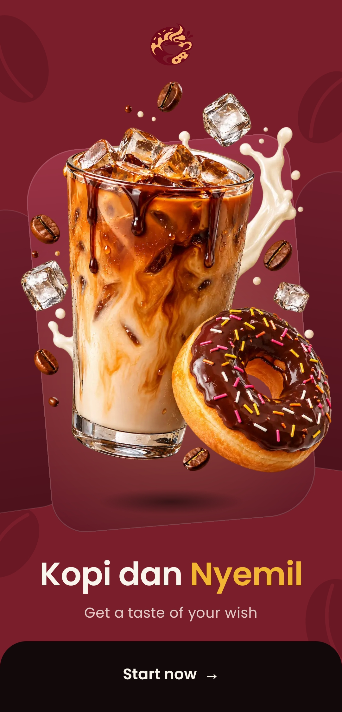 | 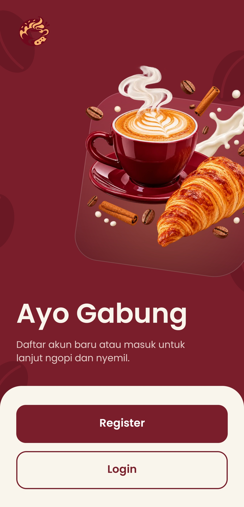 | 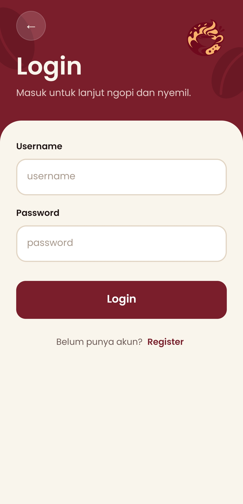 |

| Register | Home | Detail Menu |
|:---:|:---:|:---:|
| 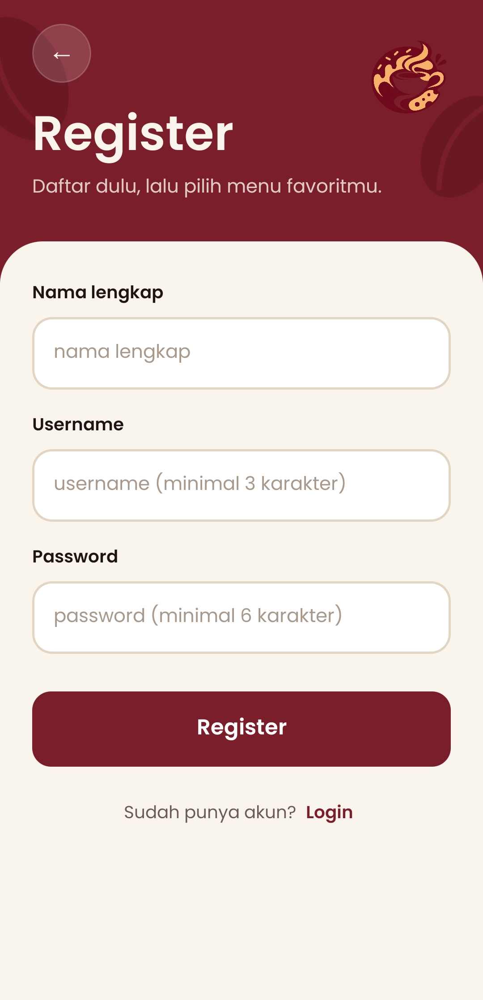 | 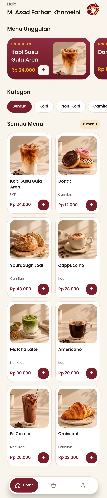 | 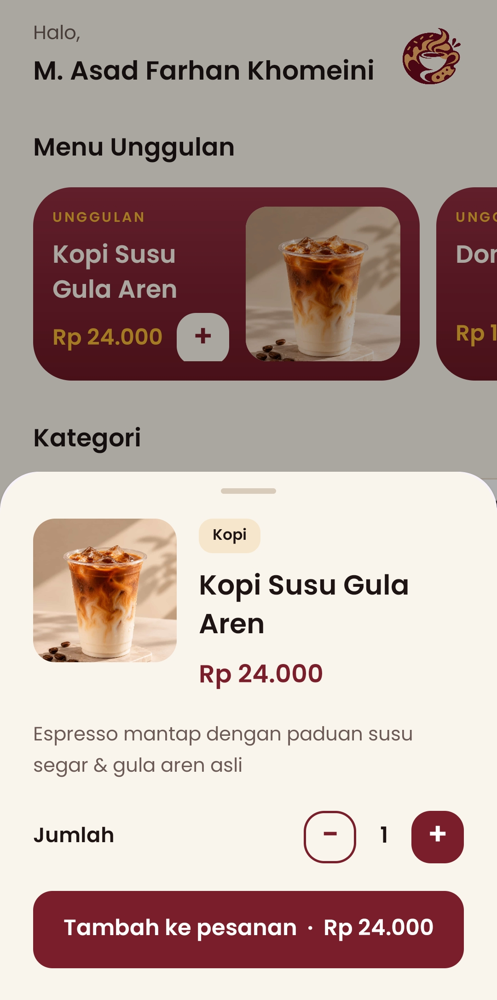 |

| Menu Kopi | Menu Non-Kopi | Menu cemilan |
|:---:|:---:|:---:|
| 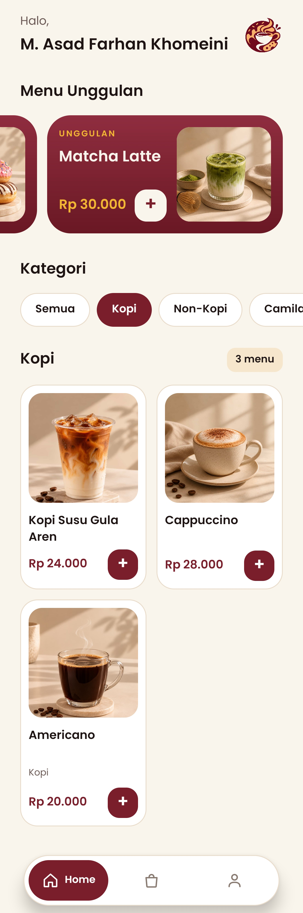 | 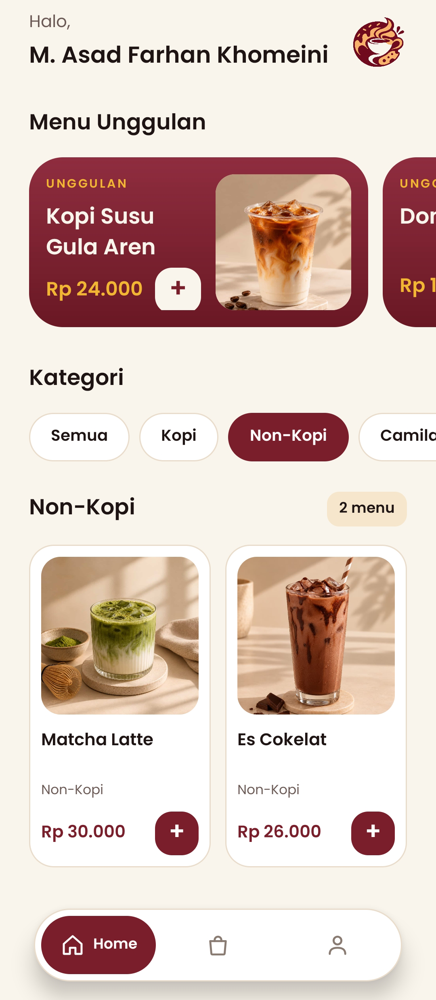 | 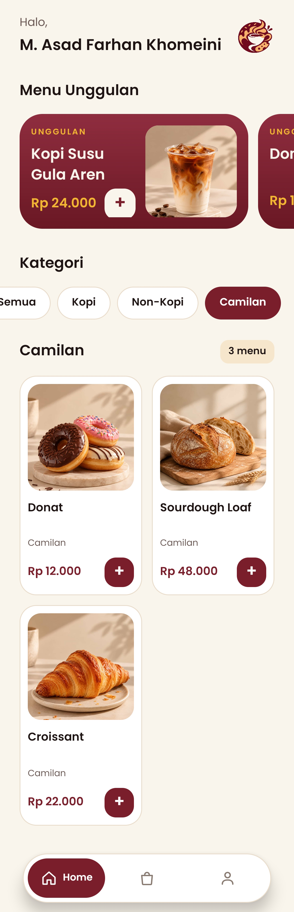 |

| Order (kosong) | Order (berisi) |  Qris (dummy)  |
|:---:|:---:|:--:|
| 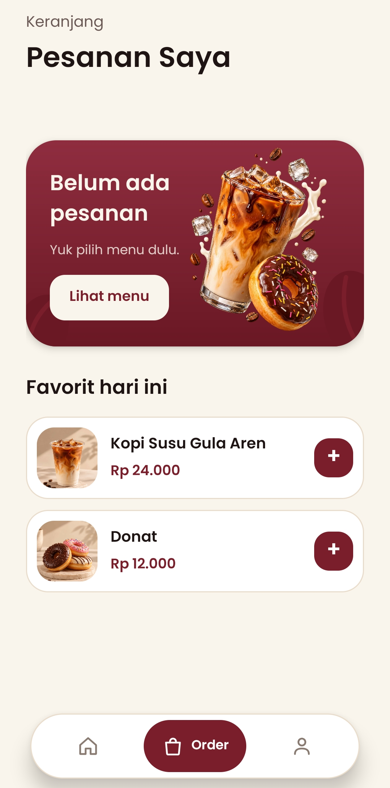 | 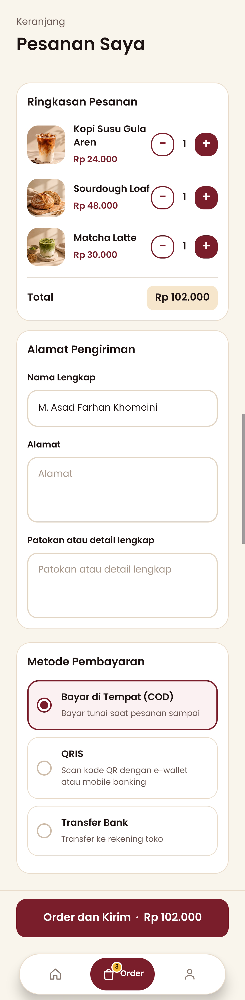 | 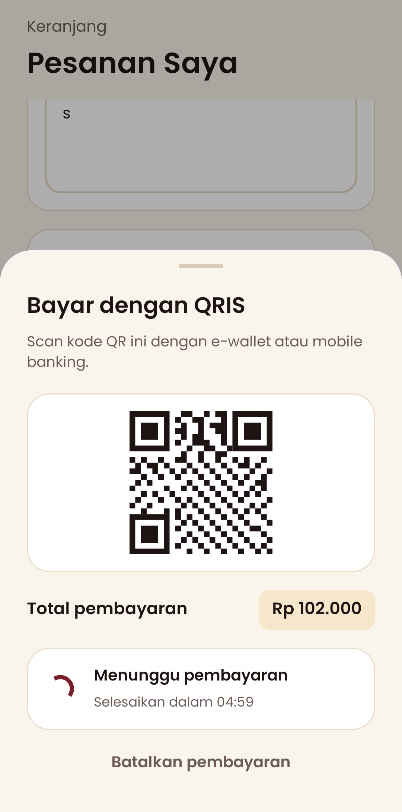 |

| Konfirmasi Pesanan | Profile |                       Bank Dummy                       |
|:---:|:---:|:------------------------------------------------------:|
| 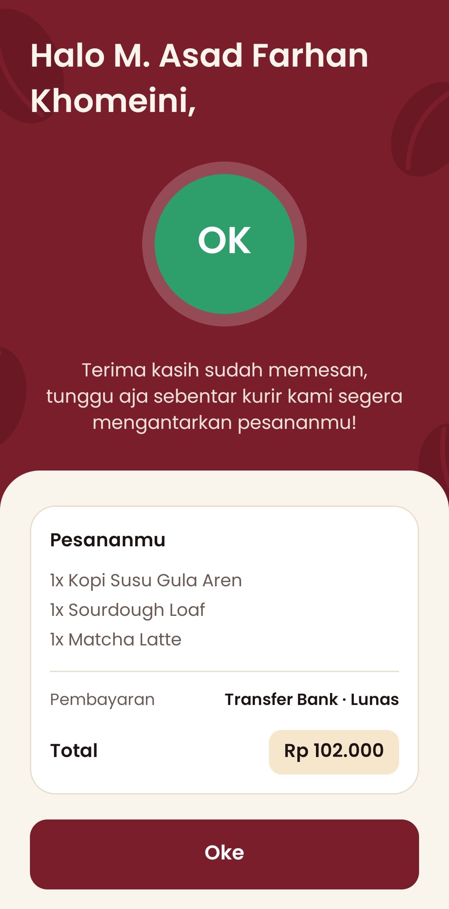 | 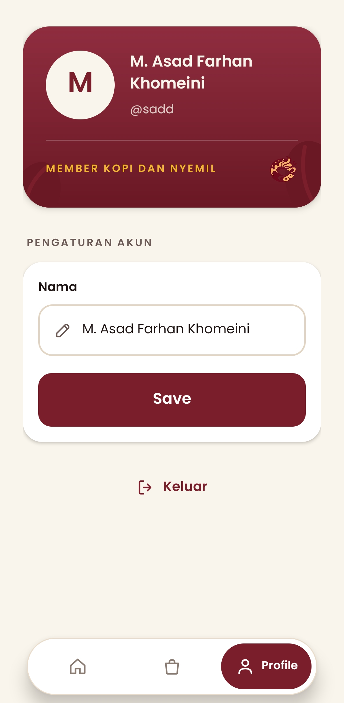 | 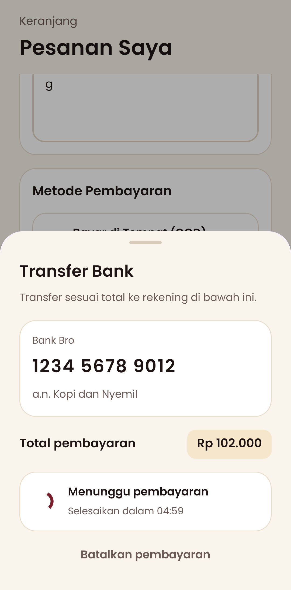  |

## Fitur

### Fitur sesuai wireframe

| Layar pada wireframe | Implementasi |
|---|---|
| Splash / Welcome | Layar pembuka dengan nama, tagline, dan tombol **Start now** menuju Sign up |
| Sign up | Layar "Ayo Gabung" dengan pilihan **Register** dan **Login** |
| Register | Form nama lengkap, username, dan password, dengan validasi |
| Login | Form username dan password, dengan pesan kesalahan jika data tidak cocok |
| Home | Sapaan nama dan daftar menu makanan dan minuman (8 item) |
| Profile | Sapaan nama, pengaturan nama dengan tombol **Save** |
| Alamat Pengiriman (Order) | Form nama lengkap, alamat, patokan atau detail lengkap, dan tombol **Order dan Kirim** |
| Konfirmasi Pesanan | Sapaan nama, tanda OK, pesan terima kasih, dan tombol **Oke** |
| Bottom navigation (opsional) | Digunakan: Home, Order, Profile |

Layar Alamat Pengiriman ditampilkan sebagai bagian dari tab **Order**, menyatu dengan ringkasan pesanan dan metode pembayaran, bukan sebagai layar terpisah.

### Pengembangan di luar wireframe

- **Home:** menu unggulan yang dapat digeser ke samping, kategori (Semua, Kopi, Non-Kopi, Camilan), dan daftar menu dalam 2 kolom.
- **Detail menu:** ketuk kartu menu untuk membuka lembar detail (setengah layar) berisi foto, kategori, harga, deskripsi, pengatur jumlah, dan tombol tambah ke pesanan.
- **Notifikasi keranjang:** setelah menambah menu, muncul notifikasi kecil dengan aksi **Lihat** menuju tab Order, dan lencana jumlah pesanan pada ikon Order.
- **Keranjang interaktif:** tombol tambah dan kurang pada tiap item, total harga dihitung otomatis, dan item hilang saat jumlahnya nol.
- **Order kosong:** tampilan "Belum ada pesanan" dengan ajakan melihat menu dan dua saran menu favorit.
- **Metode pembayaran:** Bayar di Tempat (COD), QRIS, dan Transfer Bank.
- **Simulasi pembayaran:** untuk QRIS dan Transfer Bank muncul lembar pembayaran berisi kode QR atau nomor rekening, total, status "Menunggu pembayaran", dan hitung mundur. Setelah beberapa detik aplikasi menandai pembayaran diterima secara otomatis (pengganti notifikasi payment gateway), lalu melanjutkan ke konfirmasi. Pengguna dapat membatalkan pembayaran, dan pesanan tidak diproses.
- **Konfirmasi:** menampilkan ringkasan item yang dipesan, metode pembayaran, dan total.
- **Profile:** kartu member dengan avatar inisial, nama, dan username, serta tombol **Keluar**.
- **Akun tersimpan di perangkat:** data akun yang didaftarkan tetap ada setelah aplikasi ditutup. Password disimpan dalam bentuk hash SHA-256.
- **Validasi Register:** nama lengkap wajib diisi, username minimal 3 karakter tanpa spasi, password minimal 6 karakter.
- **Nama panjang:** teks nama menyesuaikan ukuran dan tidak terpotong. Kolom nama dibatasi 30 karakter.
- **Tampilan dan gerakan:** transisi halus antar layar (memudar dan membesar ringan), geser horizontal antar tab, animasi masuk elemen, dan layar dikunci pada orientasi vertikal.

## Alur Penggunaan

1. **Welcome:** tekan **Start now**.
2. **Ayo Gabung (Sign up):** pilih **Register** untuk membuat akun atau **Login** jika sudah punya akun.
3. **Register:** isi nama lengkap, username, dan password, lalu tekan **Register**. Pengguna langsung masuk ke Home.
4. **Login:** isi username dan password, lalu tekan **Login**.
5. **Home:** telusuri menu unggulan, pilih kategori, atau ketuk kartu menu untuk melihat detail. Tekan **+** untuk menambahkan satu item ke keranjang.
6. **Order:** periksa ringkasan pesanan dan ubah jumlah bila perlu, isi nama lengkap, alamat, dan patokan, pilih metode pembayaran, lalu tekan **Order dan Kirim**.
7. **Pembayaran:** pilihan COD langsung diproses. Pilihan QRIS atau Transfer Bank menampilkan lembar pembayaran yang dikonfirmasi otomatis (simulasi).
8. **Konfirmasi Pesanan:** lihat ringkasan pesanan, lalu tekan **Oke** untuk kembali ke Home.
9. **Profile:** ubah nama lalu tekan **Save** (sapaan di Home ikut berubah), atau tekan **Keluar** untuk kembali ke awal.

## Data Menu

Data menu bersifat statis (dummy) dan terdapat pada `MenuData.kt`. Harga merupakan perkiraan dan hanya untuk keperluan tugas.

| Menu | Kategori | Harga | Menu unggulan |
|---|---|---:|:---:|
| Kopi Susu Gula Aren | Kopi | Rp 24.000 | Ya |
| Donat | Camilan | Rp 12.000 | Ya |
| Sourdough Loaf | Camilan | Rp 48.000 | |
| Cappuccino | Kopi | Rp 28.000 | |
| Matcha Latte | Non-Kopi | Rp 30.000 | Ya |
| Americano | Kopi | Rp 20.000 | |
| Es Cokelat | Non-Kopi | Rp 26.000 | |
| Croissant | Camilan | Rp 22.000 | |

## Teknologi yang Digunakan

- **Bahasa:** Kotlin
- **Platform:** Android (minimum SDK 24), dikembangkan di Android Studio dengan Gradle Kotlin DSL
- **Antarmuka:** layout XML (Views) dengan View Binding
- **Komponen AndroidX dan Material:** Fragment, ViewPager2, RecyclerView (daftar horizontal dan grid 2 kolom), NestedScrollView, dan BottomSheetDialogFragment (Material Components)
- **Penyimpanan:** SharedPreferences untuk akun lokal, dan objek Kotlin di memori untuk keranjang dan data menu
- **Keamanan sandi:** hash SHA-256 melalui `MessageDigest`
- **Grafis:** vector drawable dan shape XML, serta huruf Poppins
- **Animasi:** ViewPropertyAnimator, ObjectAnimator, dan animasi transisi XML
- **Tampilan penuh layar:** pengaturan edge-to-edge dengan WindowInsets

## Struktur Proyek

```
app/src/main/
├── java/lat/pam/kopidannyemil/
│   ├── KopiApp.kt               Inisialisasi aplikasi (memuat akun, mengunci orientasi vertikal)
│   ├── MainActivity.kt          Welcome
│   ├── SignUpActivity.kt        Pilihan Register / Login
│   ├── LoginActivity.kt         Login
│   ├── RegisterActivity.kt      Register
│   ├── HomeActivity.kt          Host tiga tab (ViewPager2), navbar, notifikasi keranjang
│   ├── HomeFragment.kt          Menu unggulan, kategori, grid menu
│   ├── OrderFragment.kt         Keranjang, alamat pengiriman, metode pembayaran
│   ├── ProfileFragment.kt       Profile
│   ├── ConfirmationActivity.kt  Konfirmasi pesanan
│   ├── MenuDetailSheet.kt       Lembar detail menu
│   ├── PaymentSheet.kt          Lembar pembayaran (simulasi)
│   ├── MenuAdapter.kt           Adapter daftar unggulan dan grid menu
│   ├── MenuData.kt              Data menu (dummy)
│   ├── CartStore.kt             Keranjang belanja
│   ├── UserStore.kt             Data akun (SharedPreferences)
│   ├── Payment.kt               Daftar metode pembayaran
│   ├── TabRefresh.kt            Penyegaran antar tab
│   └── UiExt.kt, GestureExt.kt, SheetExt.kt, TextExt.kt, SquareImageView.kt   Utilitas tampilan
└── res/
    ├── layout/    Layout XML seluruh layar, lembar, dan item daftar
    ├── drawable/  Gambar menu, ilustrasi, ikon vektor, dan bentuk (shape)
    ├── font/      Huruf Poppins
    ├── anim/      Animasi transisi antar layar
    └── values/    Warna, tema, dan gaya
```

## Cara Menjalankan Aplikasi

**Prasyarat**
- Android Studio versi terbaru
- Emulator atau perangkat Android dengan Android 7.0 (API 24) atau lebih baru
- Koneksi internet saat sinkronisasi Gradle pertama kali

**Langkah**
1. Salin repository:
   ```
   git clone https://github.com/USERNAME/kopi-dan-nyemil.git
   ```
2. Buka Android Studio, pilih **File, Open**, lalu pilih folder `kopi-dan-nyemil`.
3. Tunggu proses **Gradle Sync** selesai.
4. Pilih emulator atau hubungkan perangkat (USB debugging aktif).
5. Klik tombol **Run** (segitiga hijau).
6. Masuk dengan akun demo di bawah ini, atau buat akun baru lewat **Register**.

## Akun Demo dan Catatan Penggunaan

| | |
|---|---|
| Username | `budi` |
| Password | `123456` |

- Aplikasi menyimpan **satu akun**. Mendaftarkan akun baru menggantikan akun sebelumnya, termasuk akun demo.
- Tidak ada fitur lupa password. Jika lupa, daftar ulang lewat Register.
- Keranjang disimpan di memori dan kosong kembali setelah aplikasi ditutup.

## Kesesuaian dengan Ketentuan Tugas

| Ketentuan | Pemenuhan |
|---|---|
| Mengimplementasikan seluruh tampilan dan fitur pada wireframe (Splash/Welcome, Sign Up, Login, Register, Home, Profile, Alamat Pengiriman, Konfirmasi Pesanan) | Seluruh layar dan alur ada (lihat tabel pada bagian Fitur) |
| Tidak perlu menggunakan database, data boleh statis | Data menu statis. Hanya akun lokal yang disimpan dengan SharedPreferences, tanpa database |
| Desain boleh dikembangkan agar lebih menarik, modern, dan mudah digunakan | Tampilan dan sebagian fitur dikembangkan (lihat Pengembangan di luar wireframe) |
| Bottom navigation bersifat opsional | Digunakan: Home, Order, Profile |
| Halaman daftar makanan dan minuman minimal 5 item | 8 item menu |
| Unggah source code ke GitHub dengan README berisi deskripsi, fitur, teknologi, cara menjalankan, dan screenshot | Dipenuhi pada repository dan dokumen ini |

## Keterbatasan dan Pengembangan Selanjutnya

Keterbatasan aplikasi saat ini:
- **Pembayaran bersifat simulasi.** Tidak ada transaksi nyata, dan status pembayaran diterima dihasilkan otomatis oleh aplikasi sebagai pengganti notifikasi payment gateway.
- **Satu akun lokal.** Tidak ada server atau database, sehingga tidak ada pemulihan password dan tidak ada banyak pengguna.
- **Tidak ada riwayat dan pelacakan pesanan.** Setelah konfirmasi, pesanan tidak disimpan.
- **Tidak ada akun admin.** Menu hanya dapat diubah lewat kode.
- **Alamat berupa teks.** Tanpa peta atau validasi lokasi.
- **Hanya orientasi vertikal dan mode terang.**
- **Belum ada pengujian otomatis khusus aplikasi.**

Pengembangan yang dapat dilakukan:
- Backend dan database untuk akun, menu, dan pesanan
- Integrasi payment gateway yang sesungguhnya
- Pemulihan password lewat email atau kode verifikasi
- Riwayat dan pelacakan status pesanan
- Akun admin untuk mengelola menu
- Pemilihan lokasi pengiriman dengan peta
- Dukungan mode gelap dan orientasi lanskap

## Aset

- Huruf **Poppins** dari Google Fonts (SIL Open Font License).
- Gambar hero, logo, dan sebagian foto menu dibuat dengan bantuan AI generatif.
- Ikon navigasi dan ilustrasi sederhana dibuat sendiri sebagai vector drawable.
